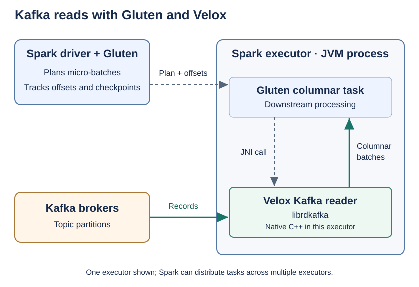

# Kafka with Gluten and Velox

Gluten's experimental Kafka integration offloads eligible Spark Structured
Streaming micro-batch reads to the Velox backend. Queries use Spark's existing
`readStream.format("kafka")` API. Gluten changes how the Kafka scan executes:
the native reader uses librdkafka to produce columnar batches inside each
Spark executor.

Spark continues to plan micro-batches, schedule tasks, and manage checkpoints
and streaming sinks. Kafka writes use Spark's Kafka writer.

## How Gluten reads Kafka



1. **Spark** resolves topic partitions and plans offset ranges for each micro-batch.
2. **Gluten** replaces an eligible Kafka scan with
   `MicroBatchScanExecTransformer`. Executor tasks pass the Substrait plan and
   partition splits through JNI to Velox.
3. **Velox** reads each topic partition over `[startOffset, endOffset)` using
   librdkafka and returns columnar batches. Supported downstream operators can
   also run natively.

The native reader disables automatic consumer-group offset commits and offset
storage; Spark owns checkpoint progress. The diagram shows one executor, but
Spark can distribute tasks across multiple executors.

## Supported reads

- Kafka DataSource V2 **micro-batch reads** are eligible for offloading. Batch
  reads, continuous processing, and Kafka writes are outside this native path.
- Supported columns are `key` and `value` (`binary`), `topic` (`string`),
  `partition` and `timestampType` (`int`), `offset` (`long`), and `timestamp`
  (`timestamp`). Decode keys and values in the query as needed.
- The native reader does not support `headers`. Filters run above the scan;
  Kafka predicate pushdown is not supported.
- Spark's driver uses the Java Kafka client; native readers use librdkafka.
  Unknown native properties are skipped, and Java JAAS, callback, and credential
  settings are not translated. Validate both client paths before using TLS or
  SASL. The example uses a local PLAINTEXT broker.

## Build Gluten with Kafka support

The commands below use **Spark 3.5.5, Scala 2.12, and JDK 17 on Linux**, matching
the Kafka CI build configuration. The Gluten checkout must include the Velox
Kafka scan offload rule and native Kafka plan conversion, as well as the native
reader. Building the reader alone does not enable scan offloading.

Follow the prerequisites in the
[Velox build guide](../backends/velox/get-started/Velox.md), then build native
libraries before the JVM bundle:

```bash
export JAVA_HOME=/path/to/jdk-17
export PATH="$JAVA_HOME/bin:$PATH"
export PROMPT_ALWAYS_RESPOND=y

./dev/builddeps-veloxbe.sh --enable_vcpkg=ON --enable_kafka=ON \
  --enable_s3=OFF --enable_gcs=OFF --enable_hdfs=OFF --enable_abfs=OFF

./build/mvn clean install -Pbackends-velox -Pspark-3.5 -Pscala-2.12 \
  -Pjava-17 -Pkafka -Pfast-build -DskipTests
```

Both Kafka build options are disabled by default:

- `--enable_kafka=ON` builds the native Kafka connector and installs librdkafka.
- `-Pkafka` includes Gluten's JVM Kafka integration in the build.

`buildbundle-veloxbe.sh` does not add the `kafka` Maven profile automatically.

## Start Spark with Gluten

Set `GLUTEN_JAR` to the exact bundle produced under `package/target/`, and use a
Spark distribution and Kafka package with matching Spark and Scala versions:

```bash
export SPARK_HOME=/path/to/spark-3.5.5
export GLUTEN_JAR=/absolute/path/to/gluten-velox-bundle.jar

"$SPARK_HOME/bin/spark-shell" --master 'local[2]' \
  --packages org.apache.spark:spark-sql-kafka-0-10_2.12:3.5.5 \
  --jars "$GLUTEN_JAR" \
  --conf spark.plugins=org.apache.gluten.GlutenPlugin \
  --conf spark.memory.offHeap.enabled=true \
  --conf spark.memory.offHeap.size=1g \
  --conf spark.shuffle.manager=org.apache.spark.shuffle.sort.ColumnarShuffleManager
```

The Spark Kafka package supplies the source and sink APIs; the Gluten bundle
supplies native execution. Both are required at runtime. The `1g` off-heap
allocation is for this small local example. Local mode runs Spark tasks in one
process; the diagram shows the distributed deployment model.

## Example: read Kafka with Gluten

Use Spark's `rate` source to populate a Kafka topic, then read the topic with
Gluten and print the results to the console. The producer supplies sample data;
the consumer's Kafka scan is the operation to check for native offloading.
The producer/consumer setup follows the
[OpenLake Kafka walkthrough](https://github.com/minio/openlake/blob/main/spark/end-to-end-spark-structured-streaming-kafka.md).

### 1. Create a topic

Start a local broker at `localhost:9092`, set `KAFKA_HOME` to the Kafka installation,
and create a fresh topic from another terminal:

```bash
"$KAFKA_HOME/bin/kafka-topics.sh" --bootstrap-server localhost:9092 \
  --create --topic gluten-kafka-rate-demo --partitions 2 --replication-factor 1
```

For a cluster, replace `localhost:9092` throughout with broker addresses reachable
from both the driver and executors, including Kafka's advertised listener addresses.

### 2. Produce and consume records

Run this block in `spark-shell` using `:paste`. The consumer starts first, and
producer and consumer use separate checkpoints:

```scala
import java.nio.file.Files
import org.apache.spark.sql.streaming.Trigger

val liveRunDir = Files.createTempDirectory("gluten-kafka-rate-").toUri.toString
val liveTopic = "gluten-kafka-rate-demo"
val bootstrapServers = "localhost:9092"

val consumed = spark.readStream
  .format("kafka")
  .option("kafka.bootstrap.servers", bootstrapServers)
  .option("subscribe", liveTopic)
  .option("startingOffsets", "earliest")
  .option("failOnDataLoss", "true")
  .load()
  .selectExpr("topic", "partition", "offset", "CAST(value AS STRING) AS value")

val consumer = consumed.writeStream
  .format("console")
  .outputMode("append")
  .option("truncate", "false")
  .option("checkpointLocation", liveRunDir + "consumer-checkpoint")
  .trigger(Trigger.ProcessingTime("2 seconds"))
  .start()

try {
  val producer = spark.readStream
    .format("rate")
    .option("rowsPerSecond", 10)
    .load()
    .selectExpr("CAST(value AS STRING) AS value")
    .writeStream
    .format("kafka")
    .option("kafka.bootstrap.servers", bootstrapServers)
    .option("topic", liveTopic)
    .option("checkpointLocation", liveRunDir + "producer-checkpoint")
    .trigger(Trigger.ProcessingTime("2 seconds"))
    .start()

  try {
    producer.awaitTermination(15000)
  } finally {
    producer.stop()
  }

  consumer.processAllAvailable()
  consumer.explain(true)
} finally {
  consumer.stop()
}
```

The producer targets 10 rows per second and stops after the timed wait. The
consumer drains the topic, prints its plan, and stops. Use a dedicated topic
without other producers so draining can finish. Console output includes each
record's topic, partition, offset, and value; the exact row count can vary.

Each run creates fresh local checkpoints and rereads existing topic records.
For deployment, use persistent checkpoint locations accessible to the cluster
and reuse them on restart; recovered offsets take precedence over `startingOffsets`.

## Verify Gluten offloading

The example calls `consumer.explain(true)` after processing records. Inspect
that output or the executed streaming plan in Spark UI for
**`MicroBatchScanExecTransformer`** on the Kafka source. This is the Gluten scan
node; console output alone does not confirm native Kafka execution.

If the Kafka scan remains on Spark, check the Gluten bundle, native library,
Kafka offload integration, and requested columns. Native operators elsewhere
in the plan do not prove that the Kafka scan was offloaded.

## Troubleshooting

| Symptom | Check |
| --- | --- |
| Kafka data source missing | Supply the matching `spark-sql-kafka-0-10` runtime package. |
| Kafka scan stays in Spark | Confirm `GlutenPlugin` is loaded, both Kafka build options are enabled, and the build includes Velox Kafka scan offloading. |
| Unsupported native schema | Use the supported Kafka columns listed above; `headers` is not supported. |
| Native read times out | Check broker reachability, authentication compatibility, offset availability, and poll timeout. |

See Spark's [Kafka integration guide](https://spark.apache.org/docs/3.5.6/structured-streaming-kafka-integration.html)
for full source options. Native consumers default to `read_uncommitted` unless
`kafka.isolation.level` is supplied.
